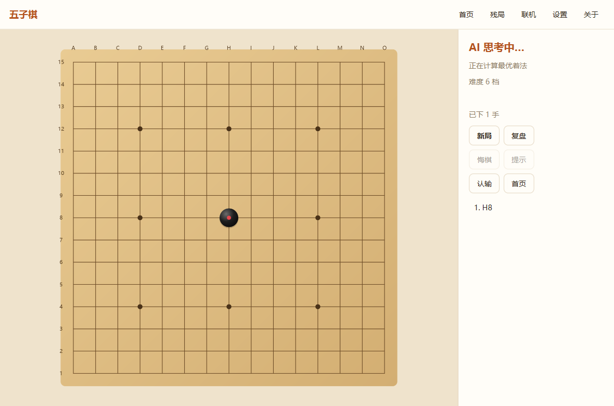

# Gomoku · 五子棋

面向商品化的五子棋产品：自研规则内核、可调难度的搜索 AI、联机对战与跨平台桌面客户端。

> **v2.0 正在重构中。** 规则内核、AI、JavaFX 桌面客户端与联机服务端基础版已完成；
> 迁移期内仍可用 [`gomoku-legacy`](gomoku-legacy/) 中的 Swing 客户端体验完整功能。

[](https://github.com/lizhongv/Gomoku/actions/workflows/ci.yml)




## 当前进度

| 模块 | 状态 | 说明 |
| --- | --- | --- |
| `gomoku-core` 规则内核 | ✅ 已完成 | 15/19 路棋盘、无禁手与连珠禁手、棋型识别、Zobrist、胜负与和棋 |
| `gomoku-ai` 搜索引擎 | ✅ 已完成 | 迭代加深、置换表、Killer/历史启发、VCF、12 档难度、提示接口 |
| 基准与测试 | ✅ 已完成 | 50 题战术题库 100% 通过；`./mvnw verify` 全绿 |
| JavaFX 桌面客户端 | ✅ 基础版 | 单机对局、联机大厅、复盘、设置、主题、中英双语 |
| 联机服务端 v2 | ✅ 基础版 | 权威裁决、房间、快速匹配、断线重连、ELO 积分与每手限时 |

## 能力

**规则内核**

- 15×15 / 19×19 棋盘，无禁手与连珠（黑方三三、四四、长连禁手）两种规则。
- 棋型识别按「再走一手会得到什么」定义，覆盖五连、活四、冲四、活三、眠三、活二及跳型。
- 落子、撤销、邻域候选与 Zobrist 哈希，搜索与界面共用同一份规则，避免各写一套胜负判定。

**搜索引擎**

- 迭代加深 α-β（PVS 框架），带时间预算；超时丢弃未完成的一层，不影响已得结果。
- 置换表（Zobrist）、Killer 与历史启发排序；先看一手胜、一手防，再做 VCF 连续冲四搜索。
- 12 档难度：时间、深度、候选宽度与随机度组合，1 档适合新手，12 档用于认真对弈。
- 提供 `analyze()` 返回前 N 个候选与评分，供界面提示、复盘与「AI 教练」使用。

**基准结果**（详见 [docs/benchmarks/AI-BENCHMARK.md](docs/benchmarks/AI-BENCHMARK.md)）

| 项目 | 结果 |
| --- | --- |
| 战术题库 | 50/50 通过（一手胜 16、一手防 16、VCF 18） |
| 自对弈（8 档 vs 4 档） | 8 档胜率 95%（19/20） |
| 对 v1 深度 3 引擎 | 8 档胜率 95%（19/20），5 档持平（10/20） |
| 搜索速度 | 约 0.74 万节点/秒（单线程，开发机） |

## 快速开始

要求 JDK 17 及以上；首次运行由 Maven Wrapper 自动下载 Maven 与依赖。

```bash
git clone https://github.com/lizhongv/Gomoku.git
cd Gomoku
./mvnw verify                 # 编译、格式与静态检查、测试、覆盖率
```

体验 JavaFX 桌面客户端：

```bash
./scripts/run-desktop.sh      # Windows 用 scripts
un-desktop.bat
```

生成界面截图（用于文档与改动后的回归检查）：

```bash
./scripts/screenshots.sh
```

迁移期的 Swing 客户端仍可用：

```bash
./mvnw -pl gomoku-legacy -am package
java -jar gomoku-legacy/target/gomoku-legacy.jar
```

运行 AI 基准：

```bash
./mvnw -q -pl gomoku-ai -am compile
java -cp "gomoku-core/target/classes:gomoku-ai/target/classes" \
  io.github.lizhongv.gomoku.ai.bench.BenchmarkMain 20
```

Windows 下 classpath 分隔符用 `;`。

## 项目结构

```
Gomoku/
├── gomoku-core/       规则内核：棋盘、规则、棋型、胜负（零第三方依赖）
├── gomoku-ai/         搜索引擎：评估、排序、置换表、VCF、难度与基准
├── gomoku-protocol/   联机协议：JSON 帧、版本协商与消息类型
├── gomoku-server/     联机服务端：权威棋局、房间、重连与持久化
├── gomoku-legacy/     迁移期的 Swing 客户端与联机服务端（v1）
├── docs/              架构、AI 设计、规则、开发指南、基准报告
├── config/            Checkstyle 等工程配置
├── mvnw / .mvn/       Maven Wrapper
└── pom.xml            父 POM
```

依赖方向：`gomoku-ai → gomoku-core`；客户端与服务端在后续阶段只依赖这两个模块，不再复制规则。

## 文档

| 文档 | 内容 |
| --- | --- |
| [docs/ARCHITECTURE.md](docs/ARCHITECTURE.md) | 模块划分、依赖方向、线程模型与数据流 |
| [docs/AI-DESIGN.md](docs/AI-DESIGN.md) | 评估、搜索、VCF、难度设计与实测强度 |
| [docs/RULES.md](docs/RULES.md) | 无禁手与连珠规则、禁手判定口径 |
| [docs/DEVELOPMENT.md](docs/DEVELOPMENT.md) | 构建、测试、代码规范、发布流程 |
| [docs/PROTOCOL.md](docs/PROTOCOL.md) | 联机协议 v2：帧格式、消息表、错误码与权威性 |
| [docs/DEPLOYMENT.md](docs/DEPLOYMENT.md) | 服务端部署、数据备份与桌面打包 |
| [docs/COMPETITORS.md](docs/COMPETITORS.md) | 竞品功能矩阵与差距 |
| [CHANGELOG.md](CHANGELOG.md) | 版本变更 |

## 路线图

- [x] 规则内核与搜索引擎
- [x] 战术题库、基准报告、CI 与静态检查
- [x] JavaFX 桌面客户端基础版（对局、复盘、设置、主题、双语）
- [ ] 残局题库、AI 教练提示面板、连珠模式入口
- [x] 服务端权威棋局与联机大厅（基础版）
- [x] 桌面免安装包（jpackage app-image）
- [x] MSI/DMG/DEB 打包流程（GitHub Actions，标签触发）
- [ ] 代码签名、公证与自动更新
- [ ] 英文界面与无障碍

## 参与贡献

见 [CONTRIBUTING.md](CONTRIBUTING.md)。安全问题请按 [SECURITY.md](SECURITY.md) 私下报告。

## 许可证

[MIT](LICENSE)。第三方依赖：FlatLaf（Apache-2.0）、animated-gif-lib（Apache-2.0）、MySQL Connector/J（GPLv2 + FOSS 例外）；
迁移期模块的完整依赖清单在阶段三前补齐。
