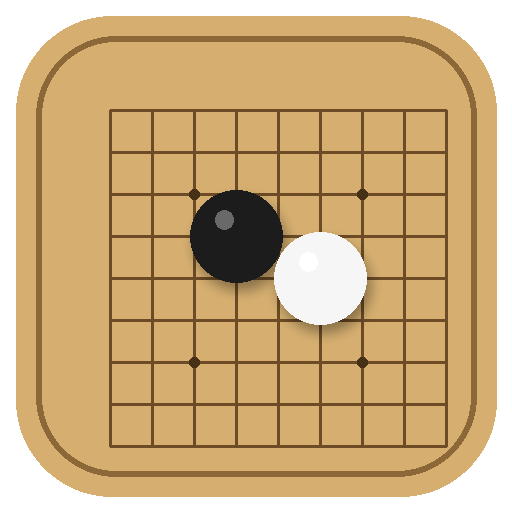
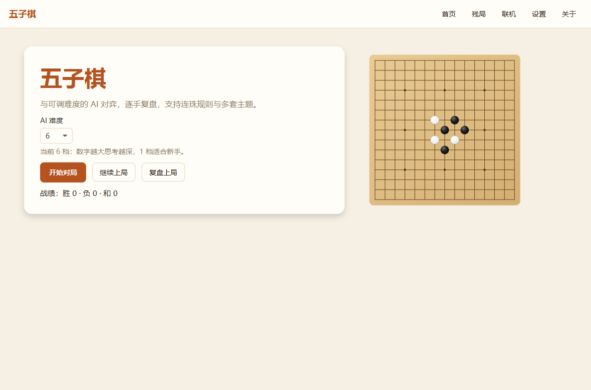
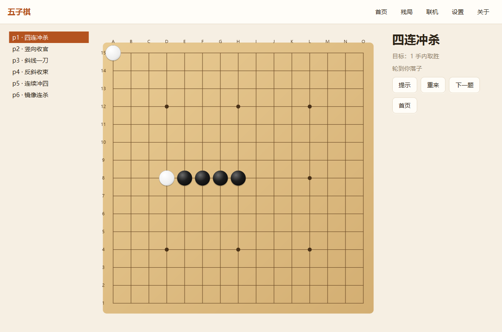
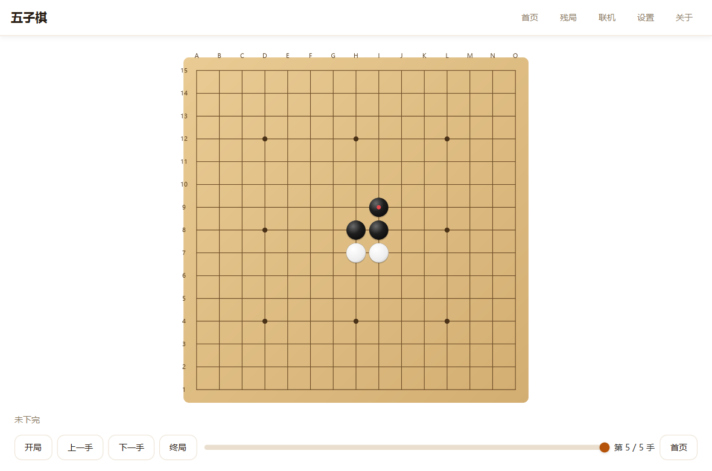
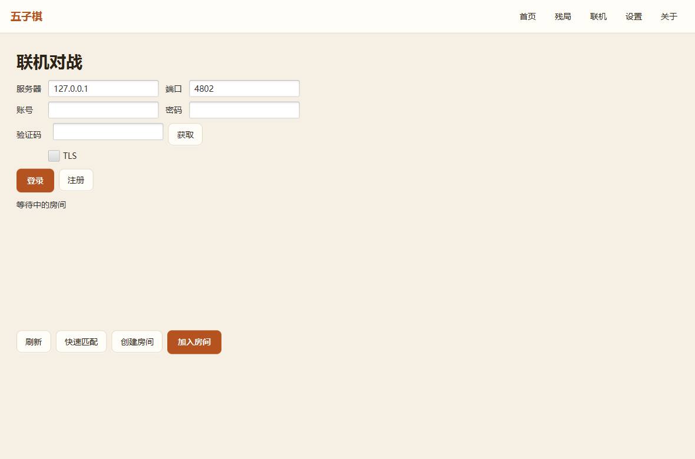
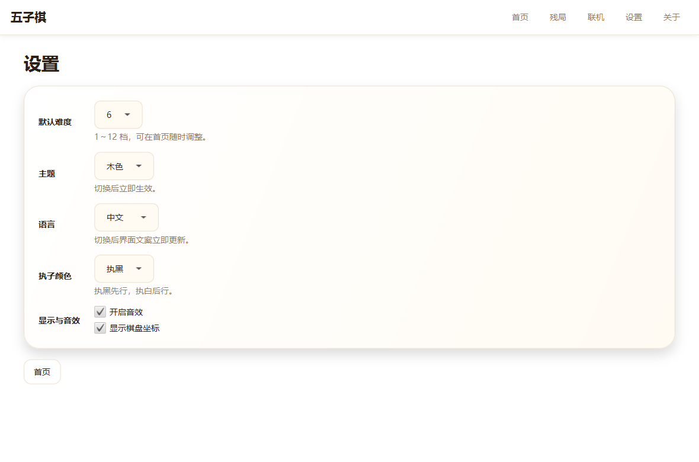
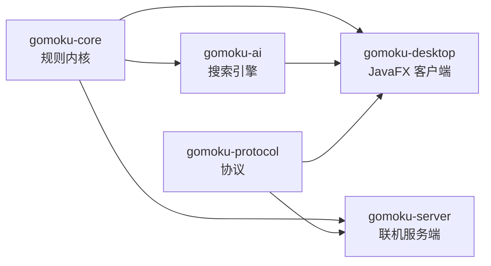

<div align="center">



# Gomoku · 五子棋

**自研规则内核 · 12 档搜索 AI · JavaFX 桌面端 · 服务端权威联机**

[](https://github.com/lizhongv/Gomoku/actions/workflows/ci.yml)
[](https://github.com/lizhongv/Gomoku/actions/workflows/package.yml)


[功能](#功能) · [截图](#截图) · [快速开始](#快速开始) · [架构](#架构) · [AI 设计](#ai-设计) · [文档](#文档) · [路线图](#路线图)


</div>

---

## 功能

| 模块 | 能力 |
| --- | --- |
| 规则内核 | 15/19 路棋盘、无禁手与连珠（黑方三三/四四/长连禁手）、棋型识别、Zobrist、胜和判定；零第三方依赖 |
| 搜索 AI | 迭代加深 α-β、置换表、Killer/历史启发、VCF 连续冲四、12 档难度、教练推荐接口 |
| 单机对局 | 12 档 AI、悔棋、提示（前三候选与评分）、认输、计时、自动保存与续下 |
| 复盘 | 按手回放，开局/上一手/下一手/终局与滑杆定位 |
| 残局 | 6 道题：一手取胜、连续冲四；提示、重来、下一题 |
| 联机 | 服务端权威裁决、房间、快速匹配、聊天、断线重连、ELO 积分、每手限时 |
| 账号安全 | PBKDF2 密码、注册算术验证码、登录失败 5 次锁定、可选 TLS |
| 界面 | 三套主题（木色/夜间/青玉）、中英双语、内置音效、随窗口缩放的棋盘 |
| 工程 | 多模块 Maven、Maven Wrapper、CI、Spotless、Checkstyle、SpotBugs、JaCoCo、三平台安装包 |

## 截图

<table>
<tr>
<td width="50%"><br><sub><b>首页</b>：版本徽章、难度选择、战绩统计、一键开局</sub></td>
<td width="50%"><br><sub><b>对局</b>：棋盘、状态、计时、着法列表与教练提示</sub></td>
</tr>
<tr>
<td><br><sub><b>残局</b>：一手胜与连续冲四，支持提示与重来</sub></td>
<td><br><sub><b>复盘</b>：逐手回放，可跳到开局、上一手、下一手或终局</sub></td>
</tr>
<tr>
<td><br><sub><b>联机</b>：登录/注册（含验证码）、快速匹配、房间列表、TLS 开关</sub></td>
<td><br><sub><b>设置</b>：难度、主题、语言、执子、音效与坐标显示</sub></td>
</tr>
</table>

截图由 `scripts/screenshots.sh` 用演示数据自动生成；界面改动后重跑即可更新。

## 快速开始

### 环境

- JDK 17 及以上（CI 覆盖 17、21）
- 无需预装 Maven，`mvnw` 会自动下载

### 运行桌面客户端

```bash
git clone https://github.com/lizhongv/Gomoku.git
cd Gomoku

./scripts/run-desktop.sh          # Windows: scripts\run-desktop.bat
```

也可以先打包再运行：

```bash
./mvnw -pl gomoku-desktop -am package -DskipTests
java -cp "gomoku-desktop/target/classes;gomoku-core/target/classes;gomoku-ai/target/classes;gomoku-protocol/target/classes" \
  io.github.lizhongv.gomoku.desktop.Launcher
```

### 联机对战

```bash
./scripts/run-server.sh           # 默认监听 4802，数据写入 ~/.gomoku-server
```

在客户端「联机」页填写 `127.0.0.1:4802`，注册（先获取验证码）后即可快速匹配或创建房间。

### 打包安装包

```bash
bash scripts/package-desktop.sh app-image   # 免安装目录
bash scripts/package-desktop.sh msi         # Windows，需要 WiX Toolset 3
bash scripts/package-desktop.sh deb         # Linux，需要 fakeroot
bash scripts/package-desktop.sh dmg         # macOS
```

推送 `v*` 标签时，GitHub Actions 会在三平台构建 MSI/DEB/DMG 并创建 Release。
代码签名与 macOS 公证尚未接入，见 [docs/DEPLOYMENT.md](docs/DEPLOYMENT.md)。

### 构建与测试

```bash
./mvnw verify      # 编译、Spotless、Checkstyle、SpotBugs、测试、覆盖率
```

当前 57 个测试：规则 36、AI 10、客户端 5、服务端 6；`gomoku-core` 行覆盖率门槛 80%。

## 架构



| 模块 | 说明 |
| --- | --- |
| `gomoku-core` | 棋盘、规则、棋型、胜负与和棋；零第三方依赖 |
| `gomoku-ai` | 评估、排序、置换表、VCF、难度分级、教练接口 |
| `gomoku-protocol` | 一行 JSON 帧、64 KB 上限、版本协商、错误码 |
| `gomoku-server` | 权威棋局、房间、快速匹配、ELO、TLS、账号与战绩 |
| `gomoku-desktop` | JavaFX 客户端：对局、复盘、残局、联机、设置 |
| `gomoku-legacy` | 迁移期保留的 Swing 客户端（v2.0 稳定后删除） |

详见 [docs/ARCHITECTURE.md](docs/ARCHITECTURE.md)。

## AI 设计

- **评估**：四方向棋型识别（五连/活四/冲四/活三/眠三/活二），双四、四三、双活三额外加分；防守权重略高于进攻。
- **搜索**：迭代加深 α-β，时间预算到点丢弃未完成层；置换表 + Killer/历史启发排序；先看一手胜/一手防，再做 VCF。
- **难度**：`SearchLimits.forLevel(1..12)` 组合时间、深度、候选宽度与随机度；低档在前三候选中随机，保证新手能赢。
- **教练**：`analyze()` 返回前三候选与评分，供提示与复盘使用。

实测（开发机，单线程）：

| 项目 | 结果 |
| --- | ---: |
| 战术题库 | 50/50 通过 |
| 对 v1 深度 3 引擎 | 8 档 19 胜 1 负（95%） |
| 搜索速度 | 约 0.74 万节点/秒 |
| 每步耗时（100 ms 预算） | P50 110 ms，P95 127 ms |

详细设计与口径见 [docs/AI-DESIGN.md](docs/AI-DESIGN.md)、[基准报告](docs/benchmarks/AI-BENCHMARK.md)。

## 文档

| 文档 | 内容 |
| --- | --- |
| [docs/ARCHITECTURE.md](docs/ARCHITECTURE.md) | 模块划分、依赖方向、线程模型与数据流 |
| [docs/AI-DESIGN.md](docs/AI-DESIGN.md) | 评估、搜索、VCF、难度设计与实测强度 |
| [docs/RULES.md](docs/RULES.md) | 无禁手与连珠规则、禁手判定口径 |
| [docs/PROTOCOL.md](docs/PROTOCOL.md) | 联机协议：帧格式、消息表、错误码、TLS 与验证码 |
| [docs/DEPLOYMENT.md](docs/DEPLOYMENT.md) | 服务端部署、数据备份、三平台打包与签名 |
| [docs/DEVELOPMENT.md](docs/DEVELOPMENT.md) | 构建、测试、代码规范、发布流程 |
| [docs/ROADMAP.md](docs/ROADMAP.md) | 路线图与待办 |
| [docs/COMPETITORS.md](docs/COMPETITORS.md) | 竞品功能矩阵与差距 |
| [CHANGELOG.md](CHANGELOG.md) | 版本变更 |

## 路线图

完整待办见 [docs/ROADMAP.md](docs/ROADMAP.md)。

- [x] 规则内核、搜索引擎与 50 题战术题库
- [x] JavaFX 客户端：对局、悔棋、提示、复盘、残局、主题、双语
- [x] 联机：服务端权威裁决、快速匹配、ELO、每手限时、断线重连
- [x] 安全：注册验证码、登录锁定、可选 TLS
- [x] 免安装包与 MSI/DEB/DMG 构建流水线
- [ ] v2.1：连珠入口、残局扩充、SGF/GIF 导出、复盘曲线
- [ ] v2.2：签名与公证、自动更新、排行榜与观战
- [ ] 英文界面完善与无障碍

## 参与贡献

见 [CONTRIBUTING.md](CONTRIBUTING.md)。安全问题请按 [SECURITY.md](SECURITY.md) 私下报告。

## 许可证

[MIT](LICENSE)。第三方依赖：FlatLaf（Apache-2.0）、animated-gif-lib（Apache-2.0）、MySQL Connector/J（GPLv2 + FOSS 例外）；
迁移期模块的依赖清单将在删除 `gomoku-legacy` 时一并清理。
