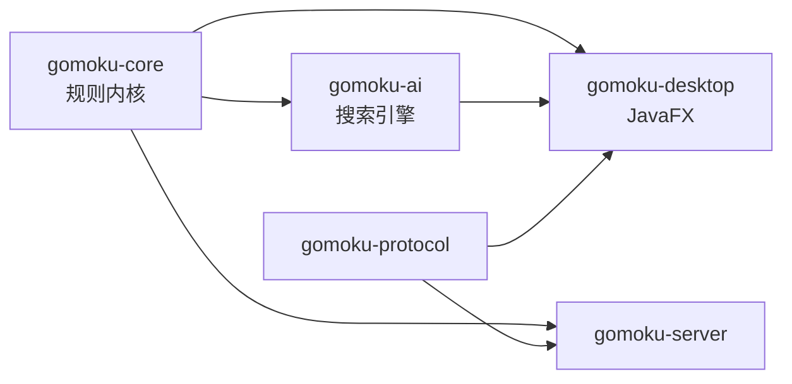
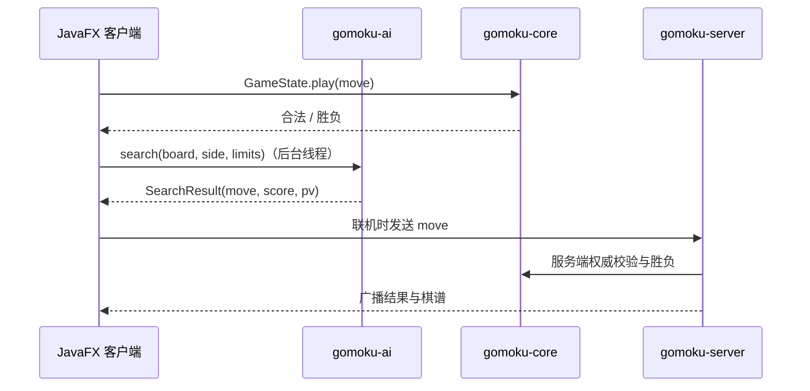

# 架构设计

> 适用版本：v2.0.0（开发中）
> 本文描述 v2 的模块划分与设计；v1 的 Swing 实现见 `gomoku-legacy/`，历史文档在 `docs/archive/`。

## 一、模块

| 模块 | 职责 | 依赖 |
| --- | --- | --- |
| `gomoku-core` | 棋盘、规则（无禁手 / 连珠）、棋型识别、胜负与和棋 | 无第三方依赖 |
| `gomoku-ai` | 评估、走法排序、置换表、VCF、难度分级、提示接口 | core、SLF4J |
| `gomoku-legacy` | 迁移期的 Swing 客户端与 Socket 服务端（v1） | FlatLaf、GIF、MySQL |
| `gomoku-desktop`（阶段二） | JavaFX 桌面客户端 | core、ai |
| `gomoku-server`（阶段三） | 联机服务端：权威棋局、房间、匹配、持久化 | core、protocol |
| `gomoku-protocol`（阶段三） | 协议帧、版本协商、错误码 | 无 |



**规则只实现一次。** 界面、AI 自对弈、服务端裁决都通过 `Board` / `GameState` 判定，不允许各写一套胜负逻辑。

## 二、规则内核 `gomoku-core`

| 类 | 职责 |
| --- | --- |
| `Board` | 可变棋盘：落子、撤销、Zobrist 哈希、邻域候选（每格维护 2 格内的棋子数） |
| `Move` | 不可变坐标值对象 |
| `Stone` | 黑 / 白 / 空，编码与协议一致 |
| `Pattern` | 单方向棋型及分值（五连 > 活四 > 冲四 > 活三 > 眠三 > 活二 > 眠二） |
| `PatternTable` | 9 格窗口查表：中心为己方棋子，其余 8 格 3^8 = 6561 种组合启动时预计算 |
| `ThreatAnalyzer` | 合并四个方向棋型，给出单点威胁与双四、四三、双活三加成 |
| `RuleSet` | 无禁手 / 连珠；连珠黑方三三、四四、长连禁手 |
| `WinDetector` | 四方向最长连子与胜负判定 |
| `GameState` | 行棋方、合法性、胜负、和棋、撤销与重放 |

**棋型识别的定义**：不是枚举所有棋形，而是按「再走一手会得到什么」逐级判断：

- 四：存在空点，填入后成五；
- 活三：存在空点，填入后成活四；
- 眠三：存在空点，填入后成四，但不构成活三；
- 活二、眠二同理向下看一层。

因此跳四、跳三、双三、双四等复合形态不需要单独维护，规则变更时也不会漏掉某个棋形。

**禁手**：黑方落子后，恰好五连优先判胜；否则长连（≥6）为禁手，双四（两个方向成四）或双三（两个方向成活三）为禁手。
这是基于局部棋型的工程近似，未实现连珠规则中「假活三」的递归排除，不能作为正式比赛裁判。

## 三、搜索引擎 `gomoku-ai`

```
search()
 ├─ 空盘 → 天元
 ├─ 一手胜 / 一手防（直接返回）
 ├─ VCF：连续冲四搜索（根节点）
 └─ 迭代加深 2, 4, 6 …
      └─ searchRoot：排序 → 逐着 α-β
           └─ negamax：置换表 → 排序 → 递归 → 写表
```

| 机制 | 作用 |
| --- | --- |
| 迭代加深 | 每层都能产出可用的着法；超时丢弃半层结果 |
| 置换表 | Zobrist 键，深度优先替换；命中 EXACT 直接返回，LOWER/UPPER 收窄窗口 |
| Killer / 历史启发 | 记录产生剪枝的着法，提高排序命中率 |
| 走法排序 | 先看自己成五、对手成五，再按双方威胁分与历史分排序 |
| VCF | 只走能成四的着法，对手被迫堵；活四或双四直接判胜；每层检查对手反成五 |
| 时间预算 | `System.nanoTime` 检查，超时异常沿栈上抛，**所有落子都在 `finally` 中撤销** |

**线程模型**：`GomokuEngine` 非线程安全，一次搜索独占一个实例与一个线程；界面必须在后台线程调用，
搜索结束再回 UI 线程更新。时间预算是软上限，超时后返回最近一次完整深度的结果。

**难度**：`SearchLimits.forLevel(1..12)` 组合时间、深度、候选宽度与随机度。低档会在前三个候选里随机，
保证新手能赢；高档不做随机。

## 四、数据流（阶段二、三）



## 五、迁移策略

1. 阶段一：core 与 ai 独立完成，旧 Swing 客户端保持可运行（`gomoku-legacy`）。
2. 阶段二：JavaFX 客户端接入 core/ai，逐页替换旧界面；旧客户端保留到功能对齐。
3. 阶段三：服务端改为权威棋局，客户端只发着法请求；旧客户端下线并删除 `gomoku-legacy`。

## 六、质量门禁

- `./mvnw verify`：编译、Spotless、Checkstyle、SpotBugs、JUnit、JaCoCo。
- `gomoku-core` 行覆盖率不低于 80%，构建失败即阻断。
- AI 战术题库 50 题必须全部通过；基准报告随版本更新。
- 提交使用约定式提交；每个阶段独立可回退。
